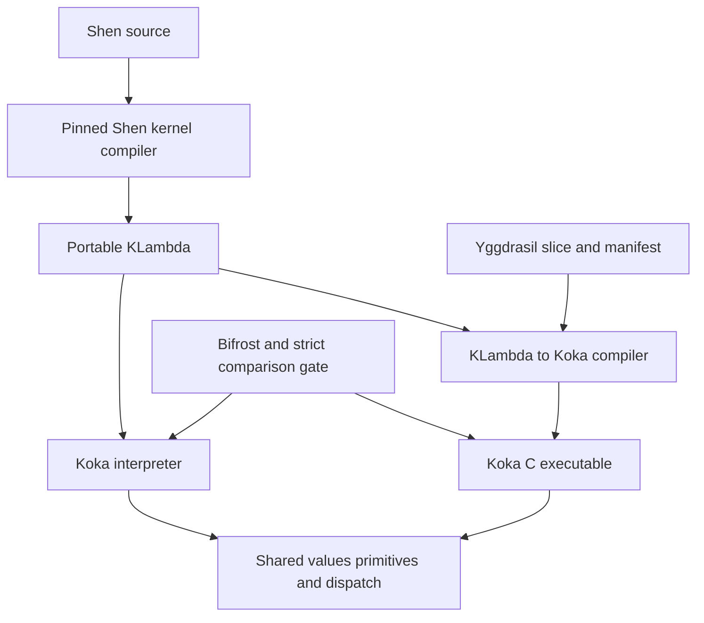

# Plan for a complete Shen port to Koka

Prepared 2026-10-11. Implementation is underway; see docs/implementation-status.md
for executed evidence and remaining gates. This plan is not a completion claim.

The goal is a complete Shen implementation hosted by Koka, usable through
Bifrost and compilable into standalone Yggdrasil artifacts. The compatibility
baseline is the pinned S42 KLambda kernel shared by the reference ports. An
effect-based search engine is a separate optimization with its own evidence.

The proposed sequence is: establish independent comparison gates; implement
KLambda and boot the existing kernel; integrate the launcher with Bifrost;
compile KLambda to Koka and integrate Yggdrasil; evaluate effect-based search
and specialization. Architecture choices below remain reviewable. Their ranking
is engineering judgment, with performance still unmeasured.

## Success criteria

A complete port supports the kernel language, the Shen reader and compiler,
pattern matching and guards, optional typechecking and sequent calculus, Prolog
including cut and binding recovery, YACC, packages and macros, standard library,
interactive REPL, script loading, `eval-kl`, and runtime definition/redefinition.
It preserves specified evaluation order, errors, vector aliasing, and streams.

The backpressure loop includes the entire pinned Shen test distribution from
the beginning of implementation, on every candidate iteration. Completion
requires that full distribution to pass, the selected Bifrost corpus with every
required cell executed, adversarial cases below, and full versus shaken
Yggdrasil comparisons. The inspected distribution contains 134 canonical
assertions in 35 report groups, plus eight bundled programmable-pattern-matching
extension assertions. Their source inventory is pinned in
`comparison/shen-suite.lock.json`. These counts describe the fixed test sources. Attempts 037 and 052 pass all
142 assertions with the documented PPM adapter enabled in both lanes.

The initial delivery targets are native C executables on aarch64 Darwin and
x86_64 Linux, followed by aarch64 Linux. Windows, JavaScript, and Wasm are
separate qualification lanes. A C executable is not automatically statically
linked or portable across operating systems.

## Architecture choices

These are ten implementation approaches, including alternatives and later
extensions. Select a baseline, a deployment path, and a search experiment; they
need not share the same representation.

| Rank | Approach | Benefit | Cost or qualification risk | Proposed role |
|---|---|---|---|---|
| 1 | KLambda interpreter in Koka plus unchanged kernel | Covers dynamic Shen with a small semantic boundary | Interpreter throughput and heap management | First complete runtime |
| 2 | KLambda to Koka compiler with interpreter fallback | Native artifacts while retaining `eval-kl` | Two execution paths must agree | Main deployment path |
| 3 | Closed KLambda to Koka compilation | Small artifacts with explicit closed symbol tables | Dynamic definition and eval need refusal or additional machinery | First Yggdrasil builder |
| 4 | Explicit KLambda machine with bytecode | Predictable stack use and dynamic execution | Bytecode tooling and another representation | Fallback if tree evaluation is too costly |
| 5 | Effects inside the existing Prolog runtime | Focused replacement of search/control helpers | Must preserve false, cut locks, counters, and trails | Narrow search experiment |
| 6 | Direct Shen Prolog to Koka search effects | Can expose branch state and resumptions directly | Reimplementing compiler semantics and meta-predicates | Later candidate backend |
| 7 | Shen typed subset to specialized Koka | Removes boxing on proven signatures | Shen types alone do not prove purity, immutability, or effect rows | Optimization after parity |
| 8 | Direct full Shen frontend in Koka | Tight integration with Koka tooling | Duplicates Shen compiler, macros, YACC, typechecker | Defer |
| 9 | Koka wrapper around Shen-Go or Shen-Lua | Fast interoperability demonstration | Does not establish Koka-owned Shen semantics | Diagnostic bridge only |
| 10 | Explicit search tree or continuation machine | Inspectable scheduling, pruning, and cancellation | More manual control machinery | Independent search oracle or fallback |

Recommendation for implementation is 1, then 2/3, with 5 measured against 10.
There is no evidence yet that effects outperform explicit continuations. Do not
make replacing the Prolog compiler a prerequisite for a complete Shen port.

## Semantic boundary

Implement KLambda first. The existing kernel compiles Shen definitions,
patterns, guards, typechecking, Prolog, and YACC onto that boundary. Compile
Shen through its own `bootstrap`/kernel path instead of inventing an incomplete
surface translator.



### Kernel identity and boot

Pin an archive hash, each pristine module hash, extensions, StLib sources,
boot sequence, patches, and redistribution notices separately. The local
Shen-Lua and Shen-Go trees share 19 identical KLambda files. Yggdrasil shares
the corresponding 15 pristine modules. See the source inventory for exact hashes.

Full-runtime boot evaluates modules and their load-time forms in dependency
order. Yggdrasil collects those forms and emits a synthetic `shen.initialise`;
slice boot installs the supplied defuns, invokes the manifest initializer once,
and executes user forms in manifest order. Never boot the full kernel behind a
slice or initialize it twice. Boot modes should be explicit in the builder API.

Keep the canonical kernel path available with native replacements disabled.
Changes to a kernel function require canonical-versus-native comparison and
recorded installation phase. Same version banner does not establish same kernel.

### Values and memory

The initial primitive inventory follows the pinned runtime registrations and
kernel requirements; P0 will turn it into a checked symbol/arity manifest.

| Family | Required boundary | Koka realization to qualify |
|---|---|---|
| Lists | `cons`, `cons?`, `hd`, `tl` | Tagged values with improper tails and catchable errors |
| Symbols and globals | `intern`, `set`, `value` | Canonical symbols and separate mutable bindings |
| Strings | `string?`, `pos`, `tlstr`, `cn`, `str`, `n->string`, `string->n` | Explicit Shen character and rendering rules |
| Numbers | `number?`, `+`, `-`, `*`, `/`, `<`, `>`, `<=`, `>=` | Boxed numeric profile with checked coercions |
| Equality | `=` | Structural/identity rules and equality-compatible hashing |
| Vectors | `absvector`, `absvector?`, `address->`, `<-address` | Stable mutable handles, sentinel slots, alias preservation |
| Errors | `simple-error`, `error-to-string`, `trap-error` | Shen error values and host handler boundary |
| Streams and time | `open`, `close`, `read-byte`, `write-byte`, `pr`, `get-time` | Byte-preserving IO and explicit ownership |
| Platform bootstrap | Standard streams, environment globals, character-stream predicates | Source-derived startup bindings |

Compiler special forms and port-provided helpers are recorded separately from
required primitives. Probe wrong arities and wrong types as well as happy paths.

Define a tagged `value` model covering empty list, booleans, symbols, strings,
numbers, cons cells with arbitrary tails, function values, mutable vector handles,
stream handles, and error values. Interned symbols, globals, and function bindings
are separate concepts. `true` and `false` interning must match the pinned ports.

Use immutable cons structures initially and stable handles for mutable objects.
Vector updates preserve identity and aliases; a Koka immutable vector copy would
change Shen behavior. Uninitialized slots contain `shen.fail!`. Specify bounds,
vector layout, equality, hash compatibility, and cyclic structures with probes.

The references allow dynamic object graphs. For the first interpreter, propose
an arena for vectors, environments, and closures whose edges are numeric handles,
with explicit roots from machine frames, globals, function tables, and host handles.
This avoids relying on host reference counting to reclaim cycles. Establish
mark/sweep or another complete lifetime policy before a long-lived REPL release.
A never-collected arena is acceptable only for a bounded bootstrap experiment.

Compiled functions need an equally explicit root/lifetime interface. Roots must
include suspended computations and values retained by handlers. Sweep only at
safe points; preserve handles or use generation checks when reusing slots.
Reject stale host handles. Stress cyclic vectors and closures after references
are released, as well as retained values across suspension.

### Numbers and strings

Keep `number` distinct from Koka's host numeric types. Shen-Go's inspected
representation uses float64, while Koka also exposes arbitrary-precision `int`.
Choosing big integers for all Shen arithmetic could change reference behavior.

Characterize integer predicates, comparisons, mixed arithmetic, division by zero,
rounding, large literals, exponent notation, negative zero, and numeric printing
against the pinned ports. If references disagree, preserve the discrepancy and
resolve it against the kernel specification rather than taking a majority vote.
Optional exact arithmetic belongs in a named extension profile.

For strings, test `pos`, `tlstr`, `cn`, `str`, `n->string`, and `string->n` with
ASCII, multibyte Unicode, embedded NUL, and out-of-range access. Preserve the
kernel's character semantics independently of byte-stream IO and platform newline
handling. Error rendering and value rendering require separate functions.

### Evaluation and dispatch

Implement `defun`, `lambda`, `let`, `if`, `cond`, `and`, `or`, `trap-error`, and
`freeze` with their non-strict rules, plus strict ordinary application. Probe
left-to-right evaluation, lexical capture, shadowing, and invalid boolean guards.
Implement currying/arity behavior at the appropriate pinned S-kernel boundary.

Represent freeze as a closure with no arguments. Repeated thaw repeats the
computation; do not substitute a memoizing lazy value. Host callable adapters
must preserve zero-argument closures and escaped function values.

Full-mode function application resolves through the current function table, so
redefinition and dynamically evaluated definitions affect subsequent calls. A
compiled direct call is allowed only when the closed program contract proves
the binding cannot change, or when a version check guards the fast path.

Use an explicit evaluation machine/trampoline for interpreter tail calls.
The compiler lowers self calls to loops and implements a bounded-stack protocol
for mutual and indirect tail calls if Koka compilation does not meet that
requirement. Million-step tail tests cover all three forms; successful Fibonacci
alone does not prove proper tail behavior.

### Runtime effects

Use a world/state abstraction for function bindings, globals, symbol interning,
the mutable heap, and streams. Begin with one conservative runtime effect row
for boxed dynamic code; infer narrower rows only for validated closed functions.
Shen's dynamic typechecker is retained. A Koka-typed interpreter does not prove
the types or effect behavior of every interpreted Shen program.

Separate a kernel failure value, a Shen error effect, and experimental search
abort. `trap-error` catches Shen errors, not ordinary failure values or every
internal implementation panic. IO uses byte-preserving adapters and explicit
stream ownership. Clock and environment primitives remain observable operations.

## Effect search experiment

The initial sketch establishes a useful host mechanism but changes several
Shen semantics. [Research](docs/research.md) explains each correction.

1. Implement host `choose` plus a distinct no-resume `search-abort`, and DFS
   collection for a pure search fragment. Branch on the Boolean result.
2. Test selection and append splits with exact solution order and multiplicity.
   Keep deterministic predicate-based list walking as a separate operation.
3. Add persistent substitutions inside the search handler. Compare them with an
   explicit trail whose mark is restored after failure, exception, and prune.
4. Classify state: substitutions and variable allocation are branch-local;
   inference budgets, diagnostic counters, globals, and IO follow pinned Shen
   behavior. Do not roll back the whole world automatically.
5. Implement cut with predicate invocation boundaries and choice-point ownership.
   Test alternatives created before versus after cut, caller alternatives, nested
   predicates, and cut followed by failure. Generic first-success is insufficient.
6. Exercise first-result, all-result, nested queries, `findall`, `is`, unification
   with and without occurs checking where exposed, failure, exceptions, and GC.
7. Compare canonical kernel search, the Koka effect engine, and a small independent
   explicit search machine on finite cases. Keep native search opt-in until gates pass.

DFS collection can be implemented with nested resumptions. BFS requires a queue
and a precise lifetime policy for stored continuations; iterative deepening
requires depth accounting; random search requires a seeded policy. Each changes
termination/order/cut interactions and is a named experimental strategy. Preserve
the kernel's default search order. No result-limit truncation counts as all-results.

## Bifrost support

Changes belong in an isolated Bifrost branch, with `shen-koka` available only
after a real launcher exists:

- Add `shen-koka` to `adapters.go`'s `implOrder`; adding JSON alone is insufficient
  because discovery and matrix output walk that list.
- Add an `adapters.json` recipe with `BIFROST_SHEN_KOKA`, sibling launcher paths,
  `eval -e`, `script`, `--version`, and REPL commands. Use argv lists.
- Provide build/install recipes after the Nix package is buildable. Mark status
  experimental and state kernel identity. Determine hush behavior with file writes.
- Compose the port's pinned `#toolchain` through `bifrost env`; do not copy Koka's
  dependencies into Bifrost or silently install an ambient compiler.
- Add `koka: shen-koka` to `shake.go`'s `targetToImpl` when the Yggdrasil target lands.
- Cover explicit selection, missing launchers, eval errors, EOF, stdin, load echo,
  clean stdout, normal scripts, file IO, and Windows launcher handling.

Keep Bifrost's existing general-purpose skip policy, but put a strict required-cell
validator around release comparisons. The seed scaffold implements that check
for this project's suite. Extend structured reports with raw stdout/stderr,
exit code, provenance, and normalization version before claiming rich trace parity.

## Yggdrasil support

Implement `shen-koka build-slice MANIFEST OUTDIR` using the same KLambda compiler
and runtime as full mode. Read only manifest-listed files, preserve top-level
order, and build without a hidden full-kernel fallback.

Add a `koka` target in `builders.json`, a builder recipe and placeholder support
where needed in Yggdrasil's Go CLI, the port-directory variable
`YGGDRASIL_SHEN_KOKA_DIR`, and toolchain checks for Koka plus its C compiler.
Document and test `koka` in target listings, parity, and Bifrost's shake path.

The builder emits generated `.kk` modules, a native executable, build manifest,
and compilation diagnostics. It needs stable mangling for punctuation, generated
variables, and collisions. Compile mutually dependent functions in groups and
register dynamic callable wrappers with the proper arities.

First accept eval-free slices, including closures, exceptions, and streams as
they become implemented. Explicitly refuse `needs-eval=true` with the established
capability exit status 3. Later carry a KLambda interpreter and the required
compiler/reader slice for eval-capable artifacts. Capability refusal remains
UNSUPPORTED and blocks any gate that requires that capability.

Populate `port_reads`, `special_forms`, native override names and installation
phase with source references and drift checks. Use `port_reads: unknown` while
the runtime is unmeasured; do not copy Go's globals. Distinguish keys consumed
today from proposed `native_deps`, `call_style`, `dispatch`, and `port_writes`
facts. New fields need consumers and validators before they count as evidence.

Qualify four legs: full interpreted, full compiled, shaken canonical compiled,
and shaken lowered compiled. Use an independent stage-1 host first, then qualify
Koka as a stage-1 host with kernel/manifest byte comparison and normalized user
KL. Full versus slice runs include stdin, errors, file bytes, and top-level order.

Start with KL-level woven trace checks and complete end markers. Static call-edge
checking requires a real Koka graph extractor or generated-source graph plus
evidence that optimization preserves its contract. SCIP is not assumed available;
level 3 remains UNKNOWN until a suitable extractor is validated. A full-kernel
linked artifact cannot establish slice-only dispatch merely by printing a golden.

## Comparison backpressure

Use three distinct oracles: pinned Shen-Lua, pinned Shen-Go, and explicit small
goldens/metamorphic invariants. Shared kernel agreement is useful but can reproduce
a shared kernel defect. Escalate disputes to a pinned upstream reference and
the specification. Preserve reference-versus-reference failures as failures.

The comparison ladder is:

| Gate | Required evidence | Failure action |
|---|---|---|
| G0 Source and toolchain | Clean revisions, kernel/module hashes, compiler and binary provenance | Stop promotion; diagnostic runs may continue |
| G1 Host primitives | Goldens for each primitive and observable edge case | Repair runtime before boot optimizations |
| G2 Full Shen suite | All 134 canonical assertions and eight bundled extension assertions, with exact inventory and per-assertion outcomes | Keep overall status red until complete; feed failures into feature work |
| G3 Cross-port | Required Lua/Go/Koka cells, ordered outputs and errors agree | Minimize counterexample; preserve logs |
| G4 Stateful semantics | Files, IO order, globals, aliasing and failures agree | Repair effect/heap boundary |
| G5 Deployment | Full versus sliced versus lowered artifact observations agree | Hold builder/lowering publication |
| G6 Harness controls | Deliberate mutants, missing ports and truncated reports rejected | Repair validator; revoke affected claims |
| G7 Performance | Correctness gates passed, reproducible distributions and memory limits | Retain baseline or defer optimization |

PASS means all required cells ran and met their oracle. FAIL means an observed
contract violation. UNKNOWN covers missing prerequisites, timeout without the
required observation, incomplete logs, and unverified provenance. UNSUPPORTED is
an explicit capability refusal. DEFERRED is deliberately unexecuted work. Every
required UNKNOWN/UNSUPPORTED/DEFERRED blocks full-port qualification and promotion
of a claimed complete capability; no skipped case is proof. Feature checkpoints
follow the development policy below while the overall full-suite gate remains red.

### Full Shen suite during feature development

The 17-case seed suite supplements the full suite. It does not replace it.
P0 pins all 63 files of the byte-identical Lua/Go test tree, the 35 canonical
report groups and their 134 assertions, and the separate eight-assertion extension
entrypoint. Keep supporting `.shen`, `.kl`, and `.axioms` fixtures, filenames
containing spaces, and the extension sources needed by their loaders.

Set up the full-suite command and report schema in P0. Attempt it on every
candidate iteration from P2 onward, before choosing the next feature to implement;
run it again after the change. Before a runnable launcher exists the attempt is
UNKNOWN with its startup blocker. Once boot and loading work, run the canonical
`runme.shen` in the test directory, preserving the upstream load order and all
assertions. Run `tests/extensions/runme.shen` separately from the distribution
root because its load paths differ. Neither lane uses a reduced feature suite.

Expected early failures are useful backpressure. Executed mismatches and language
errors remain FAIL even when their feature is unfinished. Assertions prevented
from executing by a boot/harness/load failure are UNKNOWN with the dependency
blocker; do not invent outcomes for them. Always report against the fixed 134
canonical and eight extension denominators, with stable group/ordinal IDs,
expression and expectation identities, actual outcomes, and feature blockers.
Do not remove cases, mark unfinished features passed, or treat `xfail` as PASS.

The harness asks whether to continue after a failure. A documented noninteractive
driver may answer yes at that prompt so all reachable assertions execute, while
retaining their failing outcomes. It must not patch expected values, suppress
errors, seed missing runtime semantics, or omit the typechecked half of the suite.
Preserve raw logs and capture every report: `kerneltests.shen` resets counters
at its end, so final globals or an earlier `100%` banner alone are insufficient.
Require all group counts, all assertion outcomes, normal completion, and zero
failures; unknown/unreached assertions cannot produce a green full-suite gate.

Feature checkpoints can advance while the full-suite result is red. Require the
checkpoint's declared feature assertions to pass and every previously passing
assertion to remain passing; new regressions block that checkpoint. Show both
the checkpoint result and the unchanged full-suite status in feedback. A reduced
set of passing assertions never qualifies the full port. Full-suite green is
required for P3 completion and retained for compiler, builder, search, and release
work. Bundled extensions keep a distinct result from canonical certification,
with both required for this plan's full-distribution completion.

Keep the first implementation slice focused on KLambda values, primitives,
application, control, exceptions, and closures, then boot the existing kernel.
The effect-search spike remains optional and time-bounded; it must not delay
getting the upstream suite running or replace the kernel's existing features.

Store schema version, scenario/source hash, reference identities, candidate SHA,
dirty flag, kernel/toolchain hashes, binary hashes, argv, cwd profile, selected
capabilities, seed, raw logs, normalized result, resource measurements, and
per-cell status. Bind reports to binaries built from the recorded clean checkout.
Print the first mismatch and a bounded reproduction; preserve full evidence in
an artifact rather than flooding the feedback context.

Use a portable tagged observation format for lists, improper lists, symbols,
booleans, numbers, strings, vectors with aliases, and error categories. Plain
stdout comparison remains one gate; it cannot fully observe heap identity.
Remove only declared launcher chatter, never arbitrary whitespace/error lines.

Generation uses bounded well-scoped KL, then Shen definitions, then Prolog goals.
Shrink lists, ASTs, clauses, inputs, and search depth while maintaining the same
failure. Fresh-world and repeated-session lanes catch state leakage. A tiny
explicit substitution/search oracle checks cases independent of either port.

### Twenty fault families

| ID | Injected defect or adversarial case | Required observation |
|---|---|---|
| F01 | Ignore `choose()` result | Wrong branch multiplicity rejected |
| F02 | Treat successful Boolean false as search failure | False result remains observable where specified |
| F03 | Raise an error for `(fail)` | Sentinel and trap behavior distinguish it |
| F04 | Hoist evaluation out of `freeze` | Captured side-effect sequence changes |
| F05 | Memoize thaw | Repeated thaw must repeat the computation |
| F06 | Capture wrong lexical environment | Nested shadowing golden fails |
| F07 | Eagerly evaluate if/and/or/cond branches | Untaken error or write is observed |
| F08 | Wrong operand order | Global/file trace order differs |
| F09 | Skip indirect or mutual tail-call trampoline | Bounded-stack long chain fails |
| F10 | Embed stale function binding in compiled call | Redefinition/eval changes result |
| F11 | Copy a vector on update | Alias sees stale value |
| F12 | Wrong empty slot or vector index | Sentinel/bounds golden differs |
| F13 | Leak unreachable cyclic objects | Long-session live heap fails bound |
| F14 | Hash disagrees with equality | Property get/put cannot round-trip equal keys |
| F15 | Wrong numeric coercion or rendering | Boundary arithmetic/serialization differs |
| F16 | Wrong Unicode/byte handling | String positions and binary IO differ |
| F17 | Share substitutions between branches | Later branch retains stale binding |
| F18 | Prune all search on cut | Caller/later predicate alternatives disappear |
| F19 | Wrong boot or manifest order; hidden full kernel | Init trace/read-before-write or missing-symbol checks fail |
| F20 | Missing port, skip, empty/truncated report, swallowed error | Strict validator rejects promotion |

Add error-unwind, nested query, occurs-check, variable-GC, and externally visible
side-effect cases under F17/F18. These are planned obligations, not an existing
executed 20-case test suite.

## Work phases and acceptance

| Phase | Deliverables | Exit gate |
|---|---|---|
| P0 Reproducible baseline | Source locks, full Shen suite inventory/runner contract, Nix Koka toolchain, clean reference builds, strict reports | G0, full-suite reference baselines, reference-versus-reference seed and existing Bifrost corpus |
| P1 Effect feasibility | Pure choose/abort, state-order probes, finalization, independent search model | Compiler-accepted probes; exact finite solutions and resource cleanup |
| P2 KLambda runtime | Values, primitives, parser, frames, dispatch, heap lifetime; full-suite attempts each iteration | G1 and tail/alias/error cases; feature checkpoints pass while full-suite failures remain visible |
| P3 Complete kernel | Full boot, Shen source loading, types, Prolog, YACC, macros, packages, StLib | G2/G3/G4; runnable REPL and CLI |
| P4 Bifrost adapter | Registry, launcher recipes, Nix composition, required cells | Three-port corpus, EOF/error/IO controls |
| P5 Koka compiler | Portable KL lowering, closure conversion, direct/indirect calls, mappings | Interpreter-versus-compiled parity including redefinition contracts |
| P6 Yggdrasil target | Manifest builder, canonical slices, target listing, woven trace | G5 for eval-free artifacts and explicit eval refusal |
| P7 Dynamic artifacts | Eval-capable slices, metadata, stage-1 Koka host | Dynamic definitions/typecheck/load parity; slice contract checked |
| P8 Native search | Branch-local substitutions, exact cut boundary, budgets, opt-in policy | Canonical/effects/independent model comparison and memory stress |
| P9 Optimization and release | Specialization, lowering, benchmarks, packaging, platform lanes | G0 through G7 at release SHA with required matrix complete |

P1 is a feasibility spike; it does not delay P2 if effects prove awkward. Keep
canonical Prolog operational through P3. P4's adapter may begin in P2 for a
declared KL subset, but complete support remains gated by P3. P6 can ship with
explicit eval refusal; a full-port release still requires full runtime eval.
P3 requires all 134 canonical and eight extension assertions passing; later
phases retain this gate on both canonical and optimized runtime paths.

Budget each probe and gate explicitly: start with 30 seconds per semantic case,
5 minutes per kernel group, 15 minutes per native build, 64 KiB of feedback log,
and 1 MiB per raw case stream. Use process-group cancellation and cleanup; record
truncation and timeout. These are initial configurable budgets, not performance
requirements for Shen. Heavy builds run serially by default.

Collect startup, boot, steady-state evaluation, typecheck, Prolog, YACC, compiler,
allocation/live heap, peak RSS, artifact size, and build time separately. Compare
LuaJIT on/off and Go canonical/native modes with exact flags. Run cold and warm
lanes; keep toolchain, CPU, OS, optimization, inputs, and samples in the report.
Set numerical regression budgets only after a reproducible baseline exists.

## Proposed source layout

```text
src/shen/values.kk       tagged values and stable handles
src/shen/heap.kk         arena roots and reclamation
src/shen/world.kk        globals symbols bindings and streams
src/shen/primitives.kk   KLambda primitive contract
src/shen/read-kl.kk      minimal bootstrap reader
src/shen/machine.kk      interpreter frames and trampoline
src/shen/boot.kk         full kernel and slice boot modes
src/shen/compile.kk      KL to Koka generation
src/shen/search.kk       optional effect search engine
src/shen/main.kk         eval script REPL and build-slice
kernel/                 pinned upstream modules and notices
comparison/             suites schemas observations and mutants
scripts/                bounded build comparison and evidence commands
flake.nix flake.lock     pinned compiler and host tools
docs/                   semantics architecture and integration contracts
```

The initial Koka interpreter, boot path, launcher, and evidence runner now exist.
A tracing vector collector and experimental direct native compiler now exist;
standalone compiler qualification and release gates remain incomplete. See
the implementation status for the current tested and published boundaries.

## Decisions to settle during P0 and P1

Keep the baseline kernel plus interpreter as the proposed default. Confirm the
numeric profile against actual reference behavior; choose the heap/root model
after cycle and continuation probes; choose persistent substitutions versus an
explicit trail after memory measurements. Default search remains kernel order.

The dependency flake now uses the sibling repositories' Nixpkgs pin, which
packages Koka 3.2.3. Koka 3.2.8 remains an upgrade candidate. Qualify the selected
compiler on both initial platforms. If an upgrade is required, package the exact
Koka source commit and its C runtime; verify source and dependency hashes.
`#toolchain` and development shells exist; `#shen-koka` follows the runtime.
The VS Code extension is a development
convenience; CI must use the same compiler pin.

Read and preserve Koka, Shen kernel, StLib, and copied reference code licenses
before redistribution. Benchmarking and semantic comparison require no code
copying from the ports. Any adapted code gets explicit provenance and notices.

Implementation starts with P0: clean reference worktrees, locked toolchains,
reference comparison reports, and the small compiler-checked effect probes.
